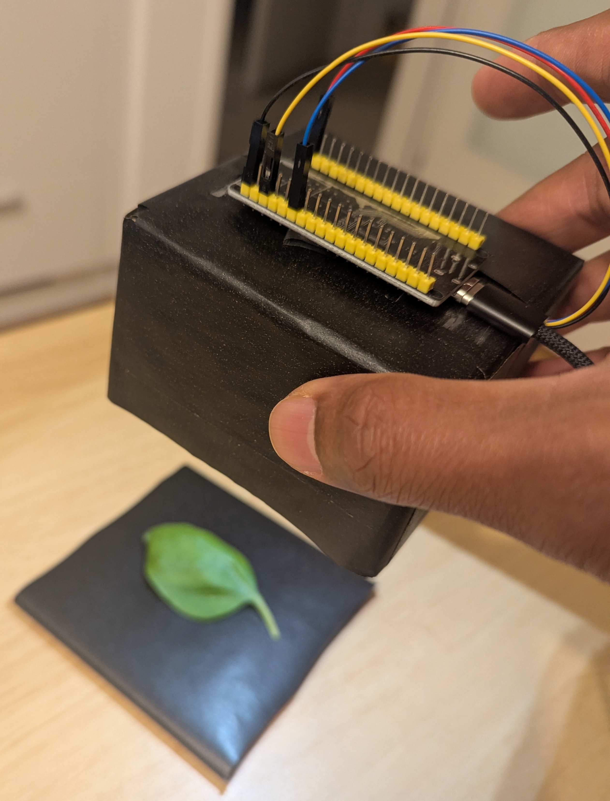
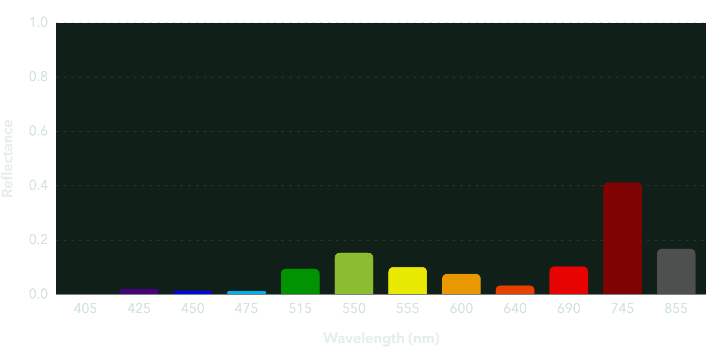
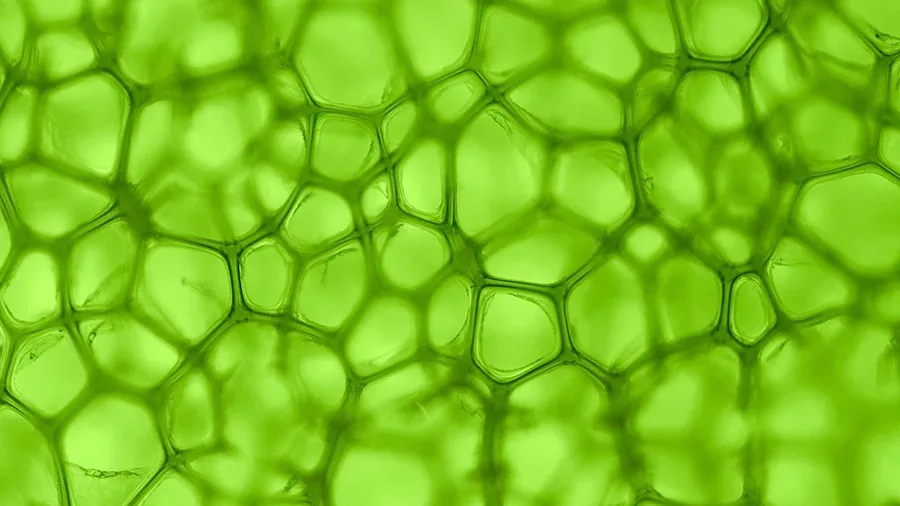

# 🍃 cropSpectAI

**Measure a leaf’s spectrum. Estimate its chlorophyll content.**

An ESP32–AS7343 measuring device and a machine learning app for estimating leaf
chlorophyll content (**Cab**, in µg/cm²). Preview spectra, predict Cab, and track
a specimen over time—or try three sample leaves without any hardware.

**[Open the live app →](https://cropspectai.streamlit.app/)**

[Demo video](firmware/esp32-as7343-spectrometer/data/device/full_demo.mov?raw=true) ·
[App guide](app/README.md) ·
[Feature equations](docs/feature_engineering.md) ·
[Run locally](#run-locally)

<table>
  <tr>
    <th align="center">1. Device setup</th>
    <th></th>
    <th align="center">2. Spectrum</th>
    <th></th>
    <th align="center">3. Chlorophyll</th>
  </tr>
  <tr>
    <td align="center" valign="middle">
      <a href="firmware/esp32-as7343-spectrometer/data/device/full_demo.mp4?raw=true">
        
      </a>
    </td>
    <td align="center">→</td>
    <td align="center" valign="middle">
      
    </td>
    <td align="center">→</td>
    <td align="center" valign="middle">
      <a href="https://www.thetreecenter.com/what-is-chlorophyll/">
        
      </a>
    </td>
  </tr>
</table>

[Watch or download the full demo (.mp4 · 29 MB)](firmware/esp32-as7343-spectrometer/data/device/full_demo.mp4?raw=true)

Chlorophyll image: [Source](https://www.thetreecenter.com/what-is-chlorophyll/)

## Try it in your browser

No installation is needed for the [hosted app](https://cropspectai.streamlit.app/).

### No device? Try a sample

1. Choose **No → Use sample data**.
2. Select a specimen to see its leaf photo and spectrum.
3. Click **Predict Cab**.

Samples use the same model as device measurements and do not save any records.

### Have an ESP32–AS7343 device?

Use desktop Chrome, a USB data cable, and the repository’s
[firmware and settings](firmware/esp32-as7343-spectrometer/README.md).

1. Connect the device and close other serial monitors.
2. Choose **Yes → Start**, then select its USB serial port. No Bluetooth pairing is needed.
3. Position the leaf, enter a **Specimen label**, and click **Measure and predict**.
4. Keep the leaf still for ten readings. Review Cab, then click **Track** to record its progress.

**Stop** pauses preview. **Reset** returns to the device question and keeps saved files.
See the [app guide](app/README.md) for connection help and tracking controls.

> [!IMPORTANT]
> **Using your own device?** The hosted app uses the repository’s dark/white
> calibration references for every device. Matching firmware alone does not
> ensure comparable predictions. Use your own references in a local checkout or
> your own deployment. [Calibration guide →](app/README.md#using-your-own-device)

## From spectrum to prediction

```text
Raw readings → calibration → average reflectance → engineered features → XGBoost → Cab
```

The current model takes **12 reflectance channels + 7 engineered features**.
The [feature reference](docs/feature_engineering.md) lists every input and equation.
The app also displays an MNDVI greenness gauge, separately from the Cab estimate.
Predictions are experimental estimates affected by calibration and measurement conditions.

## Run locally

Install Git and [uv](https://docs.astral.sh/uv/getting-started/installation/).
The project uses Python 3.14 (`.python-version` pins 3.14.4); uv can install it if needed.

```sh
git clone https://github.com/s-shivanand/cropspectai.git
cd cropspectai
uv sync --locked
uv run --locked streamlit run app/streamlit_app.py
```

Open the local URL printed by Streamlit. Choose **No → Use sample data** for your
first run. The model and samples are included; training datasets are not needed.
The first installation includes ML and notebook dependencies and may take some time.

<details>
<summary><strong>Prefer measuring from a terminal?</strong></summary>

Configure the device’s calibration references and `SERIAL_PORT` in the
[measurement guide](docs/measurement_prediction.md), then run:

```sh
uv run --locked python scripts/measure_predict.py
```

Enter a specimen label, press Enter to reuse it, or enter `q` to quit.
Browser acquisition selects the port through its permission dialog instead.

</details>

## Where measurements go

| Workflow | Storage |
| --- | --- |
| Sample data | No measurement or prediction files are written |
| Hosted device measurements | Temporary CSVs on the Streamlit server |
| Local device measurements | CSVs in your local project |

> [!NOTE]
> Hosted records may disappear after a server restart or redeployment. They are
> shared across visitors, so identical specimen labels can combine history.
> Nothing is automatically pushed to GitHub or downloaded to your computer.
> [Storage details →](app/README.md#data-and-storage)

## Explore the project

| Area | What you’ll find |
| --- | --- |
| [`app/`](app/) | Streamlit interface, browser acquisition, samples, and tracking |
| [`firmware/esp32-as7343-spectrometer/`](firmware/esp32-as7343-spectrometer/) | Device firmware, acquisition helpers, calibration, and sample assets |
| [`ml/src/cropspectai/`](ml/src/cropspectai/) | Data preparation, feature engineering, training, and evaluation |
| [`models/`](models/) | Published model and its paired feature configuration |
| [`notebooks/`](notebooks/) | Analysis and modeling experiments |

<details>
<summary><strong>Reproduce predictions or train a model</strong></summary>

The app uses `models/xgb_v_01.joblib` with
`models/xgb_best_parameters_v_01.json`. Keep them paired: the JSON specifies the
feature names and order. Samples and device measurements share the same prediction helpers.

Training datasets, intermediate files, and experiment reports are excluded from
the checkout. Obtain and prepare the source data before retraining. Follow the
[notebooks](notebooks/) and the settings documented in
[`build_evaluate_model.py`](ml/src/cropspectai/build_evaluate_model.py).
Choose a new model version to preserve the published model.

</details>

## Documentation

| I want to… | Read |
| --- | --- |
| Use samples, connect a device, or track a leaf | [App guide](app/README.md) |
| Understand the 12 channels and 7 engineered features | [Feature equations](docs/feature_engineering.md) |
| Measure from Python or configure output files | [Measurement guide](docs/measurement_prediction.md) |
| Build firmware or check sensor settings | [Firmware guide](firmware/esp32-as7343-spectrometer/README.md) |
